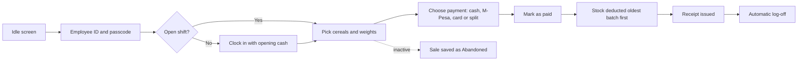
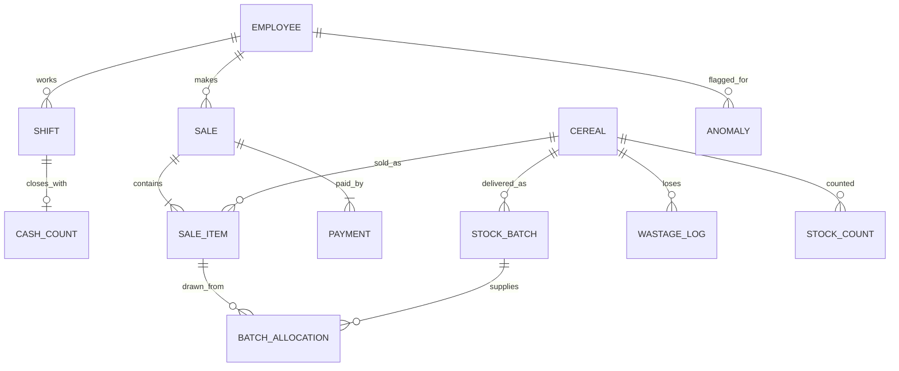

<div align="center">

# 🌾 Cereal POS

### Every kilo accounted for.

A point-of-sale and stock-control system for loose-goods cereal shops.
It tracks every employee, deducts stock oldest-batch-first, watches for spoilage,
and flags cash and stock discrepancies so the owner can see problems at a glance.


</div>

---

## Contents

- [The problem](#the-problem)
- [Features](#features)
- [Screenshots](#screenshots)
- [How a sale works](#how-a-sale-works)
- [What gets flagged](#what-gets-flagged)
- [Tech stack](#tech-stack)
- [Architecture](#architecture)
- [Getting started](#getting-started)
- [Configuration](#configuration)
- [Project structure](#project-structure)
- [Engineering notes](#engineering-notes)
- [Roadmap](#roadmap)
- [Known limitations](#known-limitations)
- [Author](#author)

---

## The problem

Small cereal shops sell by weight, take a mix of cash and M-Pesa, and usually run on a notebook. That makes it hard to answer the owner's real questions:

- *Who sold what, and when?*
- *Is the till short, and on whose shift?*
- *Why does the maize flour on the shelf not match the records?*
- *Which stock is getting old before it sells?*

Cereal POS answers those questions by giving every action an owner (an employee ID), reducing stock automatically on every sale, and comparing what the system expects with what was actually counted.

---

## Features

### 👤 Employees and access
- Owner creates employees and issues IDs. Employees choose **their own passcode** at first login.
- Passcodes are **hashed**, must be 5 to 8 digits, and reject repeated or sequential codes (`11111`, `12345`).
- **Account lockout** after 5 wrong attempts. The owner unlocks or resets from the admin.
- **One shared monitor:** the employee logs in per sale and is **logged off automatically** when the sale is paid, or after **90 seconds of inactivity**. An unfinished sale is saved as **Abandoned**, never silently deleted.
- Every login, logout, price change, void, wastage entry and stock receipt goes into an **append-only audit log**.

### 🕒 Shifts and cash control
- Clock in with the **opening cash** in the drawer. Hours worked are calculated automatically.
- **No open shift means no selling.**
- Clock out with an **end-of-shift cash count**. The system compares it with opening cash plus cash sales and flags the difference.
- The owner can force-close a forgotten shift with a logged reason.

### 🛒 Sales and payments
- Touch-friendly sale screen with a **popular cereals** panel, weight entry and a live total.
- Pay by **cash, M-Pesa, card, or any split**. Payments must add up to the total exactly.
- **M-Pesa codes** are format-checked and a code **cannot be reused** on another sale.

### 🧾 Receipts
- Unique receipt number (`RCP-20261120-0007`), date and time, cashier ID, every line (cereal, weight, unit price, total), payment breakdown and a **tax invoice reference** field reserved for KRA eTIMS.
- Receipts are never edited. Corrections go through an **owner-only void** that returns the stock and keeps the receipt on record.

### 📦 Stock management
- A **pre-loaded catalogue of 24 cereals common in Kenyan shops** (maize, unga, beans, ndengu, rice, millet and more) with Swahili names and icons. Add your own photos.
- **Receive stock** with a card picker: type a name, press Enter, tap quick-add buttons (+10, +25, +50, +90 kg bag), save.
- A cereal that is not listed can be **added and stocked in one step**.
- Each delivery is a **batch** with cost price and expiry. Sales draw from the **oldest batch first (FIFO)**.
- **Aging, expiring-soon and expired** warnings per batch, plus **low-stock** alerts per cereal.
- **Wastage and spillage log** with reasons (spoilage, spillage, pest damage, samples) and the cost of the loss.
- **Stock counts**: enter the physical weight and the system flags the gap, then adjusts to match.

### 🚩 Anomaly detection
Discrepancies are raised automatically and written in plain language, for example *"Brian's till is short by KES 800"* or *"Maize flour: system says 42 kg, counted 36 kg (6 kg missing)"*. See [What gets flagged](#what-gets-flagged).

### 📊 Owner dashboard
- **Today / Week / Month / Year** toggle, with the exact date range shown.
- Sales, transactions, average sale, estimated profit (from real batch cost), payment split, and a **comparison with the same point in the previous period**.
- Sales trend chart, top sellers, slow movers, stock health, staff snapshot and the list of things needing attention, each with a **Reviewed** button and note.

### 🎨 Design
A distinct visual identity built around the shop itself: **hessian sack texture, stencil lettering, stitched seams and scattered grains**. The owner gets a sidebar layout; cashiers get large tab buttons suited to a shared touch monitor. Fully responsive, with a live online or offline indicator.

---

## Screenshots

<table>
  <tr>
    <td width="50%"><br><sub><b>POS dashboard.</b>Welcome Point of the POS system</sub></td>
    <td width="50%"><br><sub><b>Sale screen.</b> Popular cereals, weight entry, running total.</sub></td>
  </tr>
  <tr>
    <td width="50%"><br><sub><b>Receive stock.</b> Searchable cereal cards, quick-add weights, new cereals added inline.</sub></td>
    <td width="50%"><br><sub><b>Payment.</b> Cash, M-Pesa, card or split, with M-Pesa code checks.</sub></td>
  </tr>
  <tr>
    <td width="50%"><br><sub><b>Receipt.</b> Unique number, cashier, lines, payment breakdown, tax invoice reference.</sub></td>
    <td width="50%"><br><sub><b>Admin Analytics</b>Period toggle, sales, payment split, trend, flags, stock health.</sub></td>
  </tr>
  <tr>
    <td width="50%"><br><sub><b>Stock overview.</b> Health badges and batches with expiry status.</sub></td>
    <td width="50%"><br><sub><b>Shifts and cash counts.</b> Hours, expected cash, counted cash, difference.</sub></td>
  </tr>
</table>

<div align="center">
  
  &nbsp;
  <br><sub><b>Employee login</b>
</div>

---

## How a sale works



**A typical day**

1. The owner receives a delivery: **Stock > Receive stock**. A batch is created with its cost and expiry.
2. A cashier clocks in with the opening cash and starts selling. After each paid sale they are logged off and the monitor is ready for the next person.
3. Spillage and spoilage are logged as they happen.
4. At closing, the cashier counts the drawer and clocks out. Any difference is flagged.
5. The owner opens the dashboard: one status line says whether everything is fine, and anything unusual is listed below it.

---

## What gets flagged

| Check | Raised when | Severity |
|---|---|---|
| Cash short | Counted cash is below expected (opening cash plus cash sales) by more than the tolerance | High |
| Cash over | Counted cash is above expected by more than the tolerance | Medium |
| Stock short | Physical count is below system stock by more than the tolerance | High |
| Stock over | Physical count is above system stock by more than the tolerance | Medium |
| Voids | 3 or more of one employee's sales voided in 7 days | High |
| Abandoned sales | 3 or more abandoned sales by one employee in a day | Medium |
| Odd hours | A sale made outside shop hours | Medium |
| Large wastage | A single wastage entry above the limit | Medium |
| Large sale | A single sale line above the weight limit | Low |
| Open shift | A shift left open for too long | Medium |
| Expired stock | A batch with stock left past its expiry date | High |
| Expiring soon | A batch close to its expiry date | Medium |

All thresholds are [configurable](#configuration). Each flag is raised **once**, can be marked **Reviewed**, and keeps the reviewer's note.

---

## Tech stack

| Layer | Choice |
|---|---|
| Backend | Python, Django (custom user model, ORM, admin) |
| Database | SQLite for development (PostgreSQL recommended for production) |
| Frontend | Django templates, Bootstrap 5.3, Bootstrap Icons, vanilla JavaScript |
| Imaging | Pillow (cereal photos) |
| Typography | Big Shoulders Stencil Display and Figtree (Google Fonts) |
| Styling | One hand-written theme (`static/css/theme.css`) over Bootstrap, with an SVG-mask grain background |

---

## Architecture

The project is deliberately small: **four Django apps**.

| App | Responsibility |
|---|---|
| `accounts` | Employee model and roles, login and lockout, idle auto-logout middleware, audit log |
| `inventory` | Cereal catalogue, stock batches (FIFO), wastage, stock counts |
| `sales` | Shifts, cash counts, sales, payments, receipts, voids |
| `reports` | Anomaly engine and the owner dashboard |



`BatchAllocation` records exactly which delivery each sold kilo came from. That gives **true profit** (using real cost prices) and lets a void **put stock back in the right batch**.

---

## Getting started

**Requirements:** Python 3.12+ and Git.

```bash
# 1. Clone
git clone https://github.com/DennisMuthama/cereal-pos.git
cd cereal-pos

# 2. Create and activate a virtual environment
python -m venv venv
venv\Scripts\activate          # Windows
# source venv/bin/activate     # macOS / Linux

# 3. Install
pip install -r requirements.txt

# 4. Create the database
python manage.py migrate

# 5. Create the owner account (Employee ID, Full name, Passcode)
python manage.py createsuperuser

# 6. Load the Kenyan cereal catalogue
python manage.py seed_cereals

# 7. Run
python manage.py runserver
```

Open **http://127.0.0.1:8000/**.

### Try it in five minutes

1. Click **Start sale**, log in as the owner, and open **Stock > Receive stock**. Pick *Maize Flour*, add 90 kg, set a cost and a selling price, and save.
2. Open **Staff > Employees and passcodes** and add a cashier (for example `C001`) with a temporary passcode.
3. Log out. On the idle screen click **Start sale** and log in as `C001`. You will be asked to choose your own passcode.
4. **Clock in** with an opening cash amount, then make a sale. Pay part cash and part M-Pesa to see the split.
5. After the sale you are logged off automatically and the receipt appears.
6. Log back in as the owner and open the **Dashboard**.

To see a flag, clock out as the cashier with a cash count that is a few hundred shillings short.

---

## Configuration

Everything the owner might want to tune is in `Cereal_POS/settings.py`.

| Setting | Default | Meaning |
|---|---|---|
| `SHOP_NAME` | `My Cereal Shop` | Name shown on screens and receipts |
| `CASHIER_IDLE_SECONDS` | `90` | Cashier is logged off after this much inactivity |
| `OWNER_IDLE_SECONDS` | `1800` | Same, for the owner |
| `MAX_FAILED_ATTEMPTS` | `5` | Wrong passcodes before an account locks |
| `SHOP_OPEN_HOUR` / `SHOP_CLOSE_HOUR` | `6` / `22` | Sales outside these hours are flagged |
| `CASH_TOLERANCE_KES` | `50` | Till differences up to this are ignored |
| `STOCK_TOLERANCE_KG` | `0.5` | Stock count differences up to this are ignored |
| `WASTAGE_FLAG_KG` | `2` | One wastage entry this large is flagged |
| `LARGE_SALE_KG` | `50` | One sale line this large is flagged |
| `EXPIRY_WARNING_DAYS` | `7` | A batch is "expiring soon" within this many days |
| `AGING_PERCENT` | `75` | A batch is "aging" after this share of its shelf life |
| `SHIFT_MAX_HOURS` | `14` | An open shift longer than this is flagged |
| `ABANDONED_FLAG_COUNT` | `3` | Abandoned sales per day before flagging |
| `VOID_FLAG_COUNT` | `3` | Voids in 7 days before flagging |
| `STALE_SALE_MINUTES` | `10` | An untouched open sale is marked abandoned |
| `SHOW_PRICE_BOARD` | `True` | Show today's prices on the idle screen |

---

## Project structure

```text
cereal-pos/
├── manage.py
├── requirements.txt
├── Cereal_POS/                 # project settings and root URLs
├── accounts/                   # employees, login, idle timeout, audit log
│   ├── models.py               # Employee, AuditLog
│   ├── middleware.py           # idle timeout, forced passcode change
│   ├── validators.py           # passcode rules
│   └── decorators.py           # owner_required
├── inventory/                  # cereals, batches, wastage, counts
│   ├── models.py               # Cereal, StockBatch, WastageLog, StockCount
│   ├── services.py             # FIFO deduction, wastage, stock counts
│   └── management/commands/seed_cereals.py
├── sales/                      # shifts, sales, payments, receipts
│   ├── models.py               # Shift, CashCount, Sale, SaleItem, Payment, BatchAllocation
│   └── services.py             # clock in/out, complete_sale, void_sale
├── reports/                    # anomalies and dashboard
│   ├── engine.py               # flag() and time-based checks
│   └── views.py                # dashboard with day/week/month/year periods
├── templates/                  # base layout plus one folder per app
├── static/
│   ├── css/theme.css           # the visual identity
│   └── img/grains.svg          # scattered-grain background mask
└── docs/screenshots/           # images used in this README
```

---

## Engineering notes

A few decisions worth calling out:

- **Business logic lives in `services.py`, not in views.** Selling, voiding, clocking out and stock deduction are single functions, which keeps the views thin and the rules in one place.
- **`complete_sale` is all-or-nothing.** Stock deduction, batch allocation, payments and the receipt number are written in one database transaction, so a half-finished sale cannot exist.
- **FIFO with batch allocation.** Sales take from the oldest unexpired batch and record which batches were used, so profit and voids stay accurate.
- **Custom user model** keyed on employee ID, with role-based access through a decorator and a single source of truth for admin rights.
- **Idempotent anomaly flags.** Every flag has a unique key, so re-running the checks never creates duplicates.
- **Defence in depth for auto-logout.** A browser timer logs the employee off cleanly and records it, a keep-alive ping keeps active sessions open, and a server-side session expiry covers closed tabs.
- **Append-only audit log.** The admin exposes it as read-only for everyone, including the owner.
- **Open redirects are blocked** on the login `next` parameter.

---

## Roadmap

- [ ] **M-Pesa Daraja integration** to verify that payments actually arrived, instead of trusting the typed code
- [ ] **KRA eTIMS** invoicing (the receipt already has a field for the invoice reference)
- [ ] End-of-day summary by **WhatsApp or SMS**, plus instant alerts for serious flags
- [ ] **Customer credit** ("deni") tracking
- [ ] **Bluetooth or USB scale** integration, so weights are captured automatically
- [ ] **Offline mode** with local-first storage and sync
- [ ] Native **employee management** pages in the app's own design
- [ ] Export reports to **PDF and CSV**
- [ ] Automated test suite and PostgreSQL deployment guide

---

## Known limitations

Being honest about what the system can and cannot prove today:

- **M-Pesa codes are typed by the employee.** The system checks format and blocks reuse, but cannot confirm money arrived until the Daraja integration exists.
- **Weights are typed manually**, so entry errors and fraud at the scale are still possible.
- **Time-based checks** (expired stock, unclosed shifts, abandoned sales) run when the owner opens the dashboard, not in the background.
- **Opening cash is entered by the employee** and is visible to the owner on the Shifts page.
- Developed and tested on SQLite. Use PostgreSQL for a real deployment.

---

## Author

**Dennis Muthama**, software engineering graduate Multimedia University of Kenya, based in Nairobi. Backend developer focused on Python and Django.

[GitHub](https://github.com/DennisMuthama) | [LinkedIn](https://linkedin.com/in/dennismuthama) | [Portfolio](https://dennismuthama.github.io/DennisMuthama-PORTFOLIO)

---

## License

Released under the [MIT License](LICENSE).

<div align="center"><sub>Built for the shops that sell by the scoop.</sub></div>
